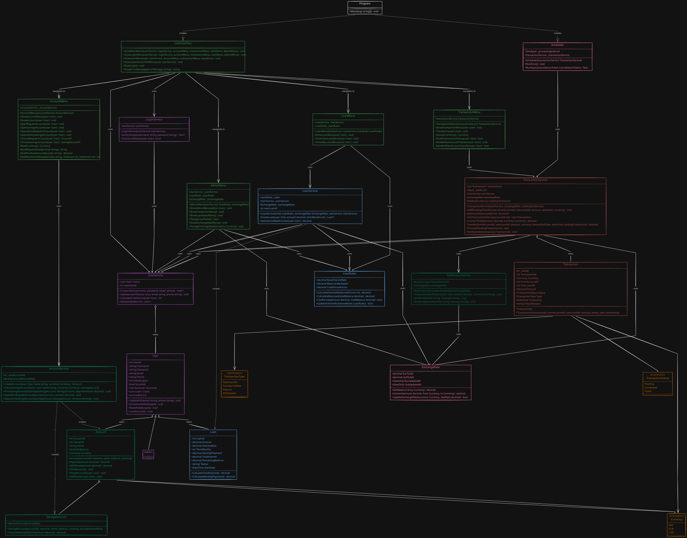

# BankApp

> A console-based banking application built in C#/.NET as a group project at Chas Academy.

---

## Table of Contents

- [About the Project](#about-the-project)
- [Features](#features)
- [Getting Started](#getting-started)
- [UML Diagram](#uml-diagram)
- [Project Structure](#project-structure)
- [Classes Overview](#classes-overview)
- [How It Works](#how-it-works)
- [Our Workflow](#our-workflow)
- [Team](#team)

---

## About the Project

This project is a console-based banking application that allows users to create accounts, perform transactions and loans, and manage the bank through an admin interface.
The goal of the project is to practice object-oriented programming (OOP) principles, collaboration using Git and GitHub, and to create a functional banking application with a user-friendly interface.

**Built with:**
- C# 14 / .NET 10 (net10.0)
- Visual Studio Community 2026 
- Git & GitHub

---

## Features

- User login menu with authentication
- User accounts get locked after 3 failed login attempts
- Users can update their personal information (email and phone number)
- Separate roles for **customers** and **admins**
- Checking and savings accounts with balances
- Multiple currencies and exchange rates
- Transfers between accounts and between users
- Notifications for large transfers (simulated text and email)
- Queued transfers processed every 15 minutes
- Transaction log / history
- Loans with interest and monthly-payment calculation
- Colored console menus and ASCII logo
- Credit score evaluation for loan applications
- Admin functions:
  - Create new users
  - Change exchange rates and loan rules

---

## Getting Started

### Prerequisites

- [.NET SDK 10.0 or later](https://dotnet.microsoft.com/download)
- [Git](https://git-scm.com/downloads)

### Run the app

```bash
git clone https://github.com/danieelvergara-cmyk/Bankapp.git
cd Bankapp
dotnet run --project BankApp
```

### Test accounts

| Role     | Username | Password |
|----------|----------|----------|
| Admin    | `admin`  | `admin`  |
| Customer | `user`  | `user`  |


---

## UML Diagram



---

## Project Structure

```
Bankapp/
├── BankApp.sln
└── BankApp/
    ├── BankApp.csproj
    ├── Program.cs              # Entry point – starts the app, no business logic
    ├── Account.cs
    ├── AccountMenu.cs
    ├── AccountService.cs
    ├── Admin.cs
    ├── AdminMenu.cs
    ├── Currency.cs
    ├── ExchangeRate.cs
    ├── Loan.cs
    ├── LoanMenu.cs
    ├── LoanRules.cs
    ├── LoanService.cs
    ├── LogInService.cs
    ├── NotificationService.cs
    ├── SavingsAccount.cs
    ├── Scheduler.cs
    ├── Transaction.cs
    ├── TransactionMenu.cs
    ├── TransactionService.cs
    ├── User.cs
    ├── UserInterface.cs
    └── UserService.cs
```

---

## Classes Overview

A rough explanation of the main classes and objects in the source code.

### Program

| Class | Responsibility |
|-------|----------------|
| `Program` | Has no business logic. It creates the services and menus, and starts the application by calling `UserInterface.ShowMainMenu()`. |

### Models

| Class | Responsibility |
|-------|----------------|
| `User` | Stores the user's personal information, `account`, `loan`, `creditScore`, and login status. |
| `Admin` |  Represents an administrator who inherits from `User` and is granted access to administrative menus and restricted functionality. |
| `Account` |  Represents a bank account with properties such as `AccountId`, `Balance`, and `Currency`. It provides methods for depositing and withdrawing money. |
| `SavingsAccount` | Inherits from `Account` and adds an `AnnualInterestRate` property. It provides a method to calculate the interest earned over a year based on the current balance and interest rate. |
| `Transaction` | Holds the history data for a money transfer as `TransactionId`, `FromAccountId`,  ` ToAccountId`,  `Amount `,  `Currency `,  `Timestamp `,  `Type `, and  `Status `  |
| `Loan` | Stores a `Loan` object with details about the loan amount, interest rate, and monthly payment, as well as methods to calculate the total amount to be paid and the monthly payment based on the loan amount and interest rate. |
| `ExchangeRate` | Stores the exchange rates for different currencies and provides methods to convert between them. |
| `Currency` (enum) | The supported currencies for the bank application, such as `USD`, `EUR`, and `SEK`. |
| `TransactionType` (enum) | Categorizes the movement of money for example `OwnTransfer` or `TransferToOther` |
| `TransactionStatus` (enum) | Tracks the transaction processing state whether `Pending` , `Completed` or `Failed` |

### Services

| Class | Responsibility |
|-------|----------------|
| `AccountService` | Creates and manages accounts, deposits money, and calculates interest for savings accounts. |
| `LoginService` |  Authenticates users, tracks failed login attempts, and locks accounts after repeated failed attempts. |
| `UserService` | Creates and manages users, assigns a `userId`, updates contact information, and calculates `creditScores`. |
| `TransactionService` | Manages the queue, verification checks, and execution of transfers.|
| `LoanService` | Creates the `Loan` object and calculates the necessary values for the loan based on the amount, interest rate, and term. |
| `NotificationService` | Sends simulated text and email alerts when a large money transfer occurs|
| `Scheduler` | Processes the transaction queue every 15 minutes, executing pending transfers and updating their status. |

### Rules

| Class | Responsibility |
|-------|----------------|
| `LoanRules` | Stores the properties and methods for evaluating loan applications based on the user's account balance, credit score, and other factors. An admin can modify the rules through the admin menu. |

### UI

| Class | Responsibility |
|-------|----------------|
| `UserInterface` | Displays the main menus, collects user input, and directs users to the correct menus and services. |
| `AccountMenu` | A menu for creating new accounts, viewing account balances, and depositing money. |
| `AdminMenu` | Admin menu for creating users, and changing exchange rates and loan rules. |
| `LoanMenu` | Menu for creating new loans and viewing existing ones. |
| `TransactionMenu` |	Displays options to send money to internal or external accounts and checks transaction histories|

### Relationships

- `Admin` inherits from `User`, and `SavingsAccount` inherits from `Account`.
- A `User` has a list of `Account` and a list of `Loan`.
- `UserService` holds all users, and `LoginService` uses it to authenticate them.
- `LoanService` uses `LoanRules` and `ExchangeRate` to evaluate loan applications.
- `TransactionService` handles transfers between accounts, and the `Scheduler` uses it to process the queue.
- `Program` creates the services and passes them to the menus. The menus talk to the services, and the services work with the models.

---

## How It Works

1. The user is prompted to log in and is authenticated via the `LoginService`.
2. Depending on the role:
   - A customer can view accounts, make transfers, open a savings account or apply for a loan.
   - An admin can create new user accounts for customers and manage rules and exchange rates.
3. New accounts and savings accounts are created via the `AccountService`. The user can deposit to both types of accounts, and the balance is updated accordingly. When depositing to a savings account, the user is also shown the estimated interest after one year, but the interest is not added to the balance.
4. A loan application is evaluated based on the rules in `LoanRules` and either approved or denied. When creating a loan, the loan is stored in the user's list of loans, separate from the user's accounts.
5. Transactions are created and managed via the `TransactionService`, which handles transfers and transaction history.
6. All transfers are placed in a queue and executed all at once every 15 minutes by the `Scheduler` service.
7. All transfers are saved in the transaction log.
---

## Our Workflow

- **Planning:** Trello, user stories, backlog, Excalidraw
- **Branching:** One feature branch per feature, merged into `dev` via pull requests.
- **Code review:** At least one other team member reviews each PR.
- **Communication:** Initially weekly meetings in our Discord hub, daily during the last week.
- **Conventions:** English for code and documentation, business logic kept out of `Main`, `.vs/`, `bin/` and `obj/` ignored via `.gitignore`.

---

## Team

| Name | GitHub | Main responsibilities |
|------|--------|-----------------------|
| William Ekman | [@TheOakMan](https://github.com/theoakman) | Loans (`Loan`, `LoanRules`, `LoanService`), logo (`UserInterface`), menus (`AdminMenu`, `LoanMenu`), exchange rate (`ExchangeRate`) |
| Daniél V | [@danieelvergara-cmyk](https://github.com/danieelvergara-cmyk) | Accounts (`Account`, `SavingsAccount`, `AccountService`, `AccountMenu`), menus ( `AccountMenu`), scheduler (`Scheduler`) |
| Rickard Idevall | [@rickardidevall-a11y](https://github.com/rickardidevall-a11y) | Users (`User`, `UserService`, `LogInService`, `Admin`), menus `UserInterface`  |
| Sabah Adam | [@DevTraveller](https://github.com/DevTraveller) | Transactions (`Transaction`, `TransactionService`, `TransactionMenu`, `NotificationService`), menus (`TransactionMenu`) |

---